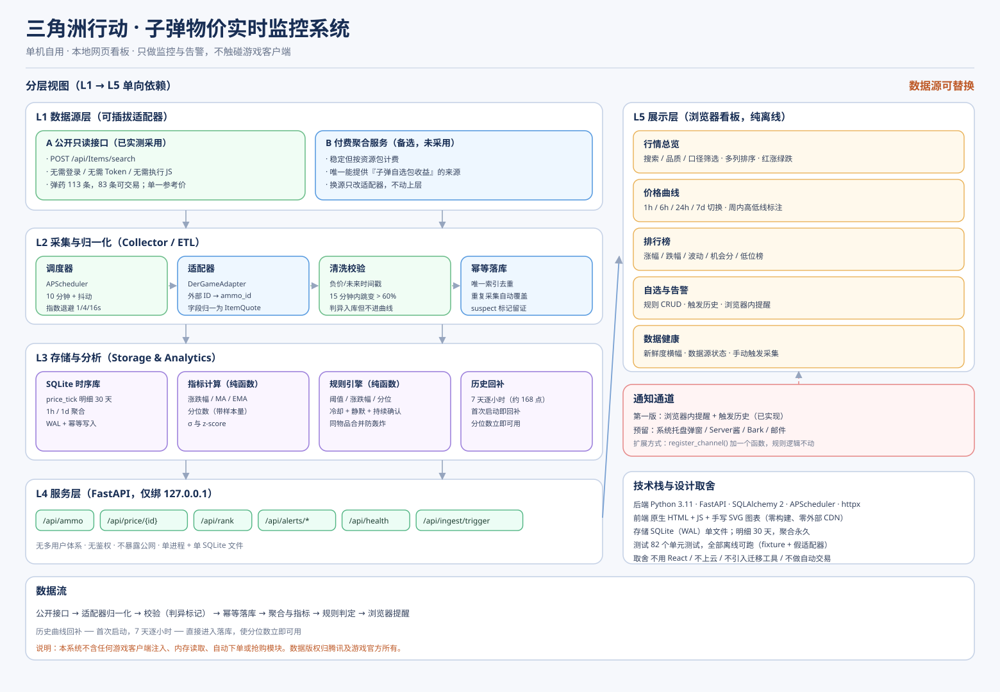
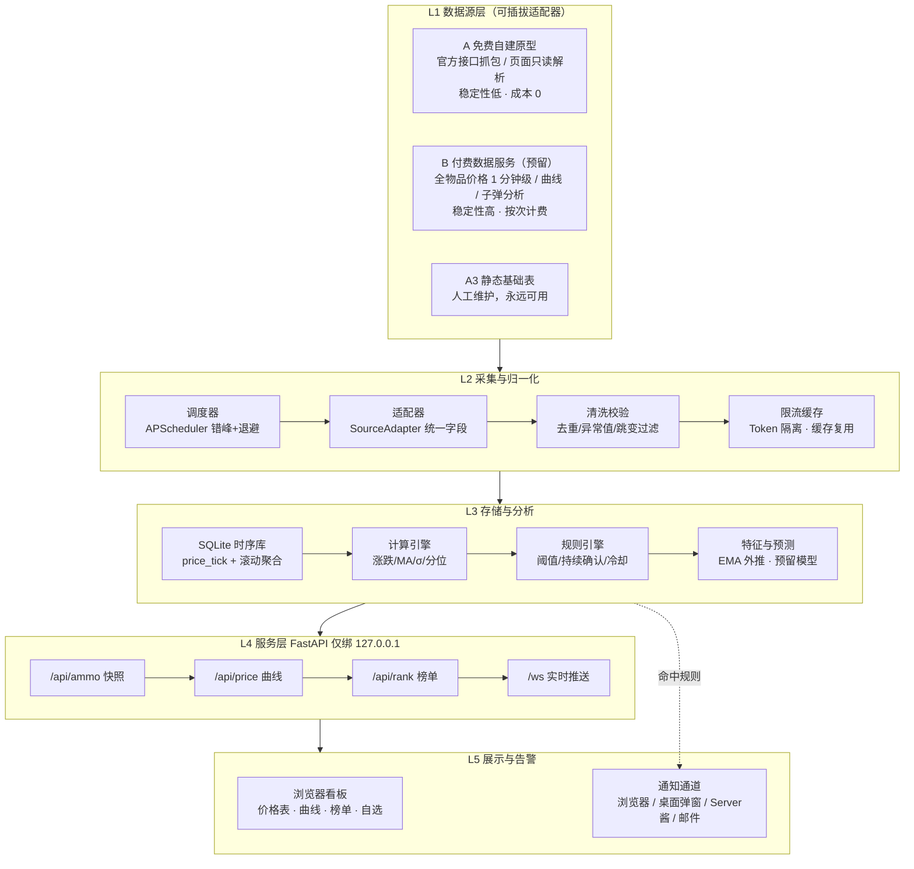

# 三角洲行动 · 子弹物价实时监控系统 —— 项目开发文档

| 项目代号 | `df-ammo-radar` |
| --- | --- |
| 文档版本 | v1.0（原型阶段 P0） |
| 定位 | **单机自用**：本机运行、浏览器看板、只做监控 / 分析 / 告警 |
| 明确不做 | 不做自动下单、不做抢购、不做游戏客户端注入或内存读取、不对外提供服务 |
| 目标平台 | Windows（当前开发机）· 可平滑迁移 Linux |
| 数据策略 | 阶段一用免费/自建来源跑通闭环；阶段二可一行配置切换到付费稳定源 |

> **一句话目标**：让我在浏览器里随时看到"所有子弹此刻多少钱、比昨天贵了多少、哪一发值得现在囤"，并在达到我设定的条件时被叫醒。

---

## 0.0 交付状态（截至 2026-10-14）

**M0 环境就绪 → M1 骨架 → M2 数据闭环 已完成并可运行。**

| 里程碑 | 状态 | 证据 |
| --- | --- | --- |
| M0 环境就绪 | ✅ | 依赖已装；`.env` 支持；工作区权限已修 |
| M1 骨架 | ✅ | FastAPI + SQLAlchemy + SQLite（WAL）建表；服务可启动；静态前端托管 |
| M2 数据闭环 | ✅ | 真实数据采集入库成功；**14,338 个价格点**；判异 0 |
| M2.5 真实数据源 | ✅ | 公开只读接口实测打通（见数据源实测报告） |
| **历史回补** | ✅ | **85/85 个可交易物品，每个 168 点（7 天逐小时）**；断点续跑 |
| M3 看板 | ✅ | 行情总览 / 自选 / 告警 / 数据健康四视图 + 手写 SVG 图表 |
| M4 告警 | 🟡 部分 | 规则 CRUD、判定引擎、触发历史、浏览器内提醒已实现；桌面弹窗/手机推送按计划留到第二版 |
| M5 加固 | 🟡 部分 | 健康检查、降级、保留策略已实现；导出 CSV 未做 |
| M6 真实数据调优 | 🟡 进行中 | 已修正 `7zf` 口径误解、写锁并发、回补间隔三处实测问题 |

### 交付物清单

| 文件 | 说明 |
| --- | --- |
| `backend/` | 完整后端（配置、模型、仓储、适配器、采集管线、指标、告警、API） |
| `frontend/` | 零构建看板（原生 HTML/JS + 手写 SVG 图表，无外部 CDN） |
| `tests/` | **124 个单元与集成测试，全部离线可跑** |
| `tools/` | 9 个只读探测与发现工具 |
| `scripts/` | `seed_catalog.py` 导入基础表、`verify_e2e.py` 端到端验收、`check_backfill.py` 回补进度 |
| `run.ps1` | 一键启动 / 停止 / 状态查询 |

### 常用命令

```powershell
# 启动（前台，排障用）
python -m backend.app

# 一键启动（后台 + 日志）
.\run.ps1
.\run.ps1 -Status
.\run.ps1 -Stop

# 跑测试（全部离线，不联网）
python -m pytest -q

# 端到端验收（对运行中的服务做真实数据校验）
python scripts/verify_e2e.py

# 查看历史回补进度
python scripts/check_backfill.py --watch 60

# 导入/刷新子弹基础表
python scripts/seed_catalog.py
```

**本机 Python 路径**（系统 `python` 未注册）：

```
C:\Users\cth\.dsh\dsh-runtimes\dsh-primary-runtime\dependencies\python\python.exe
```

### 实测中发现并修复的 8 个真实缺陷

这些都不是理论风险，而是跑起来才暴露的：

| 缺陷 | 现象 | 根因 | 修复 |
| --- | --- | --- | --- |
| **并发写冲突** | `database is locked` | 启动时"立即采集"与"历史回补"两个线程并发写 SQLite，违反单写者原则 | 进程级写锁 `write_lock`，采集非阻塞取锁、回补持锁 |
| **回补停滞** | 83 个物品只完成 2 个就卡住 | 写事务横跨 `sleep` 持有，长事务把写者卡死 | 逐项提交 + 间隔从 90s 降到 1.5s + 每 10 项进度日志 |
| **回补整批重跑** | 重启后又把 83 个物品重拉一遍 | "回补完成"只记在内存标志里，重启即丢 | 覆盖率从数据库推导（`backfill_coverage`），回补只补缺失（断点续跑） |
| **主键设计错误** | 每次采集稳定产生 2 条 −67% 假跳变 | `.300BLK` 三个品质（444/1604/4871）被合并成一个 `ammo_id`，价格来源在轮询间漂移 | 一个（名称+数据源 ID）= 一条独立价格序列；同名加品质后缀 |
| **主键冲突** | 两个箭矢共用一条价格序列 | `slugify` 只保留 ASCII，中文名全塌成 `unknown` | 保留 CJK 字符 + 写文件前做主键唯一性自检 |
| **源未更新仍写入** | 数据库无意义膨胀 | 只按采集时间戳判断，未比对源 `updateTime` | 同时比对 `src_ts` **与价格**才跳过（只比 `src_ts` 会丢掉真实价格变化） |
| **告警重复轰炸** | 每轮采集产生 13 条相同告警，看起来像"冷却失效" | 调试残留 3 条完全相同的规则，各自独立计时触发 | 创建规则时查重（对象+类型+阈值相同则 409）；同时清理了残留规则 |
| **口径误读** | UI 会显示"7 日涨跌 +118%"与实际相反 | 把数据源 `7zf` 字段当成涨跌幅（实测价格贴近 7 日最低点时它仍是大正数） | 改名 `source_index_7zf` 并标注"定义未知"；改为用 `7top`/`7down` 互校 |

> 这八个缺陷有一个共同特征：**都不会让程序崩溃，只会让数据悄悄变错或让告警变成噪音**。
> 单元测试当初全部通过，是端到端验收（`scripts/verify_e2e.py`）和人工核对反常现象发现的。
> 这就是"必须跑真实数据"的理由。

### 运行环境的一个硬约束（重要）

**常驻服务绝不要放进会被回收的后台任务里启动。**

实测踩到：在会被宿主回收的后台任务中调用 `run.ps1`，宿主终止包装进程时
**会连带杀掉整个子进程树**，服务跑了 50 分钟后神秘消失，
而 PID 文件还残留着已死进程的编号（导致 `-Status` 误报"运行中"）。

正确做法：让启动动作**快速返回**。`run.ps1` 默认模式就是如此 ——
启动并在服务可用后立即返回，之后服务独立存活（实测跨越父进程结束仍然存活）。

`-Status` 已改为**同时检查 PID 文件与端口监听**，能识别"PID 文件残留"这种假活状态。

---

## 0. 决策摘要（先看这个）

| 决策项 | 结论 | 理由 |
| --- | --- | --- |
| 形态 | 本地 Web 看板（`http://127.0.0.1:8787`） | 开发最快、图表最直观、无需打包签名、手机同局域网也能看 |
| 部署 | 单进程 + 单 SQLite 文件 | 自用场景不需要 PostgreSQL / Redis / Docker |
| 数据源 | 可插拔适配器，**接口先于实现** | 免费源不稳，付费源可换，代码不该因此重写 |
| 采集频率 | 默认 60 秒（子弹数量少，可承受高频） | 子弹是"高频物品"，官方口径下 1 分钟更新一次 |
| 存储策略 | 明细保留 30 天，小时聚合永久保留 | 明细增长快，聚合用于长期趋势 |
| 告警通道 | 浏览器通知 + 桌面弹窗为主，Server酱/Bark 可选 | 自用场景不引入机器人框架的复杂度 |
| 数据口径 | 单独维护"口径"字段（参考价/最低在售/最高收购） | **公共源通常只给一个价格**，必须显式区分，否则分析结论会错 |

### 三个必须先接受的技术现实

1. **没有官方公开接口。** 免费路线只能靠抓包拿 `openid` / `access_token`，而社区维护的官方接口文档已声明停更（[三角洲行动数据API](https://df-api.apifox.cn/)）。**这条路线随时会断，属于"原型可用、长期不可靠"。**
2. **公共数据源一般只有一个价格数字。** 真实交易行有"在售最低价"和"收购最高价"两个方向，价差正是倒子弹的利润来源。公共源多数只给一个参考价，因此：
   - 系统必须建模**价格口径**（`price_kind`），不允许把不同口径混进同一条曲线；
   - 没有双端报价时，利润分析只能做**趋势预估**，不能当作准确套利收益。
3. **口径里"子弹"和"子弹自选包/弹匣包"是不同物品。** 不同等级（白/绿/蓝/紫/金/红）的流通与打包方式不同，"倒子弹"赚的往往就是**包内单价与散卖单价之差**。系统要能把"包"和"弹"放在同一视图里比单价（元/发）。

---

## 1. 需求定义

### 1.1 用户故事（按优先级）

| ID | 用户故事 | 优先级 | 验收标准 |
| --- | --- | --- | --- |
| US-01 | 打开浏览器就能看到所有子弹的当前价格表 | P0 | 表格含名称、口径、等级、当前价、今日涨跌幅、更新时间；可排序筛选 |
| US-02 | 点某一发子弹，看它的历史价格曲线 | P0 | 支持 1h / 24h / 7d / 30d 切换，鼠标悬停显示精确时间与价格 |
| US-03 | 我想知道今天涨得最猛、跌得最狠的是哪些 | P0 | 涨跌榜各 Top 20，30 秒内刷新 |
| US-04 | 价格达到我的条件时提醒我 | P0 | 规则可配（高于/低于/涨幅超/跌幅超），触发后有通知且落库 |
| US-05 | 我想知道现在囤哪发划算 | P1 | 收益榜：按"当前价 vs N 日分位 / 均值"排序，标注置信度与样本量 |
| US-06 | 我想把常看的几发固定在首页 | P1 | 自选列表，本地持久化 |
| US-07 | 我不想被半夜的告警吵醒 | P1 | 静音时段配置 |
| US-08 | 采集断了我要知道 | P1 | 数据源健康页：最后成功时间、失败次数、连续失败告警 |
| US-09 | 我想导出数据自己算 | P2 | CSV 导出（明细/聚合） |
| US-10 | 我想在手机上瞄一眼 | P2 | 同局域网访问，响应式布局 |

### 1.2 明确的非目标（Non-Goals）

- ❌ 自动购买 / 自动挂单 / 自动抢购（违反用户协议，封号风险）
- ❌ 读取游戏内存、注入 DLL、驱动级抓包
- ❌ 多用户注册登录、云部署、公开域名
- ❌ 交易行全品类覆盖（第一阶段只做**弹药**及其相关的"子弹自选包"）
- ❌ 毫秒级行情（分钟级足够，秒级对自用毫无收益）

### 1.3 术语表

| 术语 | 含义 |
| --- | --- |
| 子弹 | 弹药类物品，含不同口径与等级 |
| 子弹自选包 / 弹匣包 | 打包出售的弹药，需折算"元/发"才能与散弹比较 |
| 口径（caliber） | 弹药规格，如 5.56 / 7.62 / 9x19 |
| 等级（tier） | 白 / 绿 / 蓝 / 紫 / 金 / 红 |
| 价格口径 | 参考价 / 在售最低价 / 收购最高价 |
| 战备值 | 官方定期更新的人工填写字段，非实时价格 |
| 资源包 | 第三方数据服务按请求次数扣费的计费单位 |

---

## 2. 总体架构



> 架构图源文件：`tools/make_arch_diagram.py`（仅依赖 Pillow）。改完分层或文案后重跑即可重新出图：`python tools/make_arch_diagram.py`

<details>
<summary>同一架构的 Mermaid 版本（便于在 GitHub / 文档站内直接渲染与 diff）</summary>



</details>

### 2.1 分层职责

| 层 | 职责 | 关键约束 |
| --- | --- | --- |
| **L1 数据源** | 提供原始价格与基础信息 | 所有外部依赖必须藏在适配器后；Token 只读环境变量 |
| **L2 采集/ETL** | 调度、限流、字段归一、异常过滤 | 幂等：同一 (ammo_id, ts, source) 重复写入只保留一条 |
| **L3 存储/分析** | 时序存储、聚合、指标、规则判定 | 聚合结果可重算；判定逻辑纯函数、可单测 |
| **L4 服务** | REST + WebSocket 暴露数据 | 只绑 `127.0.0.1`；无鉴权也应默认安全 |
| **L5 展示/告警** | 看板与通知 | 前端不做任何数据源直连 |

### 2.2 数据流

```
外部数据源
   │  (HTTP, 带 Token / 只读解析)
   ▼
SourceAdapter.fetch()  ──►  原始 dict 列表
   │
   ▼  normalize(): 映射为统一 ItemQuote
[ {ammo_id, price, price_kind, ts, source, raw} ]
   │
   ▼  validate(): 丢弃价格<=0、跳变>阈值、时间戳异常的记录
   │
   ▼  upsert()  ──►  SQLite: price_tick
   │
   ├─►  aggregate()  ──►  price_agg_1h / price_agg_1d
   ├─►  metrics()    ──►  涨跌幅、MA、σ、分位数
   └─►  rules()      ──►  命中规则 ──► alert_log ──► 通知通道
                                              │
                                              ▼
                                     WebSocket 推送到浏览器看板
```

---

## 3. 数据源方案（本项目最大的风险点，单独成章）

### 3.1 方案对比

| 方案 | 稳定性 | 成本 | 时效性 | 合规/风险 | 结论 |
| --- | --- | --- | --- | --- | --- |
| A1 官方接口 + 抓包 token | 低 | 0 | 取决于抓包频率 | 违反用户协议风险；token 易失效；账号安全风险 | 不采用 |
| A2 第三方公开页面只读解析 | 中 | 0 | 分钟级 | 公开只读接口，需礼貌访问 | ✅ **已实测打通，本项目采用** |
| A3 手工/静态基础表 | 高（因为不动） | 0 | 无 | 无 | **兜底与元数据来源，必须保留** |
| B 付费聚合服务（如三角洲数据帝） | 高（宣称 99%） | 按次计费 | 1 分钟级 | 商业服务，有 ToS 且明示数据版权归属腾讯 | 阶段二备选（唯一能提供"子弹自选包收益"的来源） |

### 3.2 阶段一（已采用）：公开只读接口

**状态：已实测打通。** 完整实测数据（字段语义、参数陷阱、覆盖率、使用礼仪）见
[数据源实测报告](数据源实测报告-dergame.md)，此处只保留结论。

| 项目 | 实测结果 |
| --- | --- |
| 主接口 | `POST https://dergame.cn/api/Items/search`，body `{"type":["弹药"]}` |
| 历史曲线 | `POST https://dergame.cn/api/Items/chartData`，body `{"itemId":"...","chartType":7}` |
| 是否需要登录 | 不需要（无 Cookie / Token / UA 校验） |
| 是否需要执行 JS | 不需要（纯 JSON API） |
| 返回内容 | 当前价、7 日涨跌比例/涨跌额、7 日最高/最低、口径、品质、占格尺寸 |
| 单次上限 | 100 条（服务端硬上限，无分页参数） |
| 弹药规模 | 113 条记录 / 111 个物品名，其中 85 条可交易 |
| 历史深度 | 7 天逐小时（约 168 点/条目） |
| 数据缺口 | **无打包弹药**（全部 1×1，无"包/匣"条目） |

**采集时的三条硬性约束**（都是踩过的坑）：

1. **不要传 `grade` 参数** —— 会让接口返回空，品质一律本地筛。
2. **不要用口径字符串当搜索键** —— 游戏内口径写法不统一（`.300BLK` 属 `7.62x35mm` 口径但
   名字里没有该串；`5.56*45mm` 用星号；`45-70 Govt` 丢前导点）。用短数字前缀做超集匹配。
3. **注意 100 条上限** —— 宽泛关键词会被截断并**静默丢数据**（实测 `name:"9"` 丢了一部分 9mm 弹药，
   改用 `name:"9mm"` 才捞全）。

**兜底设计（不可省略）**：`static_fixture` 离线源必须始终可用，它既是单元测试底座，
也是真实源失效时的降级通道（对应风险 R1）。

**基础表已自动生成**：子弹清单由 `tools/discover_all_ammo.py` 自动产出到
`backend/catalog/ammo_catalog.yaml`（113 条，其中 85 条可交易），
无需再从零手工整理；人工只需核对 `enabled` 字段。

**采集失败必须降级而不是崩溃**：日志 + UI 上的红色健康指示。
所有采集代码写在 `sources/` 下的适配器里，**切换数据源只改配置，不改上层**。

### 3.3 阶段二（可选）：切换到付费稳定源

公开只读接口没有 SLA，随时可能改版。若哪天它失效了、或你需要**打包弹药的收益分析**
（这是公开源唯一的硬缺口），可切换到付费聚合服务。

付费源的接入形态已确认可用，代表性接口（**仅作对接设计参考**，实际以官方文档为准）：

| 用途 | 接口路径 | 说明 |
| --- | --- | --- |
| 全物品基础信息 | `/v1/sjz_api/item_info_all` | 建议只请求一次，建基础表 |
| 全物品最新价格 | `/v1/sjz_api/item_price_all?isZb=0` | 含当前价、今日初始价、涨跌比例、3/7/30 日价与涨跌 |
| 价格曲线（分钟） | 见文档 | 分钟级历史 |
| 价格曲线（72 小时） | 见文档 | 含未来价值预测 |
| 子弹分析 | `子弹自选包收益` / `今日倒子弹低价预测` / `昨日倒子弹最高收益` | 直接可用的分析结论，可与自研指标互相校验 |

> 关键约束（来自官方说明，务必遵守）：
> - **Token 绝不能出现在前端或客户端**，只在服务端请求，且**必须缓存**；
> - 全物品价格接口"数据量有点大，谨慎请求"，单次消耗较多资源；
> - 价格本身有更新频率分级：高频物品 1 分钟、中频 5 分钟、低频 10 分钟 —— **不要用轮询频率去"猜"更高时效，无意义地烧钱**。

### 3.4 采集频率与错峰策略

| 数据类型 | 频率 | 说明 |
| --- | --- | --- |
| 全量价格快照 | 10–20 分钟 | 113 条弹药一次请求即覆盖；接口 `updateTime` 为分钟级，更快没有收益 |
| **历史曲线回补** | 首次启动 + 每日 1 次 | 83 次请求（每可交易条目一次），约 2 分钟。**不要放进常规轮询** |
| 基础信息库 | 每周 1 次 | 基础数据变动慢 |
| 健康检查 | 5 分钟 | 连续 3 次失败触发告警 |

错峰：在频率区间内加随机抖动（jitter），避免整点集中请求被限流。
跑批请求（如历史回补）之间的间隔保持 ≥ 1.3 秒，礼貌访问公开服务。

### 3.5 数据源健康与降级

```
连续失败 1 次  → 记 WARN 日志，指数退避重试（1s, 4s, 16s）
连续失败 3 次  → UI 顶部黄色横幅"数据可能已过期"
连续失败 10 次 → 红色横幅 + 一次通知（避免告警风暴，之后每 30 分钟提醒一次）
恢复成功      → 横幅消失 + 记录一次恢复事件
```

---

## 4. 技术栈与项目结构

### 4.1 技术选型

| 层 | 选型 | 版本 | 为什么不用别的 |
| --- | --- | --- | --- |
| 语言 | Python | 3.11+ | 数据处理生态好，自用场景开发速度最快 |
| Web 框架 | FastAPI + Uvicorn | 最新 | 自带 OpenAPI 文档与 async，WebSocket 内置 |
| ORM | SQLAlchemy 2.x | 最新 | 换库成本低；也可直接用 `sqlite3` |
| 定时任务 | APScheduler | 3.x | 进程内调度，不需要额外服务 |
| HTTP | httpx | 最新 | 支持 async、超时与重试清晰 |
| 存储 | SQLite（WAL 模式） | 内置 | 单文件、零运维；WAL 可并发读写 |
| 前端 | 原生 HTML/JS + ECharts 5 | CDN 或本地 | **零构建**，不需要 Node 工具链，改完刷新即可 |
| 通知 | 浏览器 Notification + plyer + Server酱/Bark | — | 分层降级，不依赖单一通道 |

> 前端刻意不用 React/Vue 构建链：自用看板的价值在数据，不在工程化。等真的要多人用再迁移。

### 4.2 目录结构

```
子弹/
├─ README.md                     # 5 分钟上手
├─ docs/
│  ├─ 三角洲子弹物价监控系统-开发文档.md
│  ├─ arch.svg                   # 架构图（由 tools/make_arch_diagram.py 生成，零依赖 SVG）
│  └─ data-source-notes.md       # 抓包/接口备忘（含敏感信息处理约定）
├─ tools/
│  └─ make_arch_diagram.py       # 生成架构图 PNG（仅依赖 Pillow）
├─ pyproject.toml                # 或 requirements.txt
├─ .env.example                  # 配置模板（真实 .env 不入库）
├─ data/
│  ├─ ammo.sqlite3               # 运行时生成
│  └─ fixtures/                  # 离线样例数据，保证无网也能开发
├─ backend/
│  ├─ app.py                     # FastAPI 入口 + 静态托管
│  ├─ config.py                  # 配置读取与校验（pydantic-settings）
│  ├─ db.py                      # 引擎/会话/建表
│  ├─ models.py                  # ORM 模型
│  ├─ schemas.py                 # 出参模型
│  ├─ catalog/
│  │  └─ ammo_catalog.yaml       # ★ 子弹基础表（唯一事实来源）
│  ├─ sources/
│  │  ├─ base.py                 # SourceAdapter 抽象
│  │  ├─ static_fixture.py       # 离线样例（默认启用，永远可用）
│  │  ├─ official_grab.py        # A1 抓包路线（实验）
│  │  ├─ web_scrape.py           # A2 只读解析（实验）
│  │  └─ paid_orzice.py          # B 付费源（预留，实现同一接口）
│  ├─ pipeline/
│  │  ├─ scheduler.py            # APScheduler 任务注册
│  │  ├─ normalize.py            # 字段归一
│  │  ├─ validate.py             # 异常值过滤
│  │  ├─ aggregate.py            # 1h / 1d 聚合
│  │  └─ metrics.py              # 涨跌/MA/σ/分位
│  ├─ alerts/
│  │  ├─ rules.py                # 规则判定（纯函数）
│  │  └─ notify.py               # 通知通道适配
│  └─ api/
│     ├─ routes_ammo.py
│     ├─ routes_price.py
│     ├─ routes_rank.py
│     ├─ routes_alerts.py
│     └─ ws.py
├─ frontend/
│  ├─ index.html                 # 总览：表格 + 涨跌榜 + 健康状态
│  ├─ detail.html                # 单弹详情：曲线 + 指标
│  ├─ alerts.html                # 规则管理 + 触发历史
│  └─ assets/{app.js, charts.js, style.css}
├─ scripts/
│  ├─ seed_catalog.py            # 从 yaml 建基础表
│  ├─ backfill.py                # 历史回补
│  └─ export_csv.py
├─ tests/
│  ├─ test_normalize.py
│  ├─ test_validate.py
│  ├─ test_metrics.py
│  ├─ test_rules.py
│  └─ fixtures/sample_payloads.json
└─ run.ps1                       # 一键启动（含开机自启注册说明）
```

---

## 5. 数据模型设计

### 5.1 表结构（SQLite）

```sql
-- 子弹基础表：由 catalog/ammo_catalog.yaml 导入，人工维护
CREATE TABLE ammo (
    ammo_id       TEXT PRIMARY KEY,      -- 内部稳定 ID，如 ammo_556_m855
    name          TEXT NOT NULL,         -- 展示名
    caliber       TEXT,                  -- 口径 5.56 / 7.62 / 9x19 ...
    tier          TEXT,                  -- 白/绿/蓝/紫/金/红
    is_pack       INTEGER DEFAULT 0,     -- 是否为打包出售
    pack_size     INTEGER DEFAULT 1,     -- 包内含发数，用于折算元/发
    unit          TEXT DEFAULT 'round',  -- round | pack
    tradeable     INTEGER DEFAULT 1,     -- 是否可交易
    external_ids  TEXT,                  -- JSON: {"source_b": 1234, "official": "..."}
    enabled       INTEGER DEFAULT 1,
    note          TEXT
);

-- 价格明细：时序主体
CREATE TABLE price_tick (
    id          INTEGER PRIMARY KEY AUTOINCREMENT,
    ammo_id     TEXT NOT NULL REFERENCES ammo(ammo_id),
    price       REAL NOT NULL,           -- 原始价格（按 unit 计）
    unit_price  REAL,                    -- 折算后单发价，便于跨包/散比较
    price_kind  TEXT NOT NULL DEFAULT 'reference', -- reference|ask_min|bid_max
    source      TEXT NOT NULL,           -- static_fixture|official_grab|paid_orzice
    ts          INTEGER NOT NULL,        -- 采集时间（epoch 秒）
    src_ts      INTEGER,                 -- 数据源自带的更新时间
    raw         TEXT                     -- 原始 JSON，便于回溯与排错
);
CREATE UNIQUE INDEX ux_tick ON price_tick(ammo_id, price_kind, source, ts);
CREATE INDEX ix_tick_lookup ON price_tick(ammo_id, price_kind, ts DESC);

-- 小时聚合：长期保留
CREATE TABLE price_agg_1h (
    ammo_id    TEXT NOT NULL,
    price_kind TEXT NOT NULL,
    bucket_ts  INTEGER NOT NULL,         -- 对齐到小时
    open REAL, high REAL, low REAL, close REAL,
    avg REAL, samples INTEGER,
    PRIMARY KEY (ammo_id, price_kind, bucket_ts)
);

-- 日聚合
CREATE TABLE price_agg_1d (
    ammo_id    TEXT NOT NULL,
    price_kind TEXT NOT NULL,
    bucket_ts  INTEGER NOT NULL,         -- 对齐到本地日期 00:00
    open REAL, high REAL, low REAL, close REAL,
    avg REAL, samples INTEGER,
    PRIMARY KEY (ammo_id, price_kind, bucket_ts)
);

-- 告警规则
CREATE TABLE alert_rule (
    rule_id     INTEGER PRIMARY KEY AUTOINCREMENT,
    ammo_id     TEXT,                    -- NULL = 应用于全部子弹
    rule_type   TEXT NOT NULL,           -- price_above|price_below|pct_up|pct_down|vol_spike
    threshold   REAL NOT NULL,
    window_min  INTEGER DEFAULT 60,      -- 涨跌幅比较窗口（分钟）
    confirm_min INTEGER DEFAULT 0,       -- 需持续满足多久才触发
    cooldown_min INTEGER DEFAULT 30,     -- 触发后冷却，防轰炸
    channels    TEXT DEFAULT '["browser"]',
    quiet_hours TEXT,                    -- JSON: {"from":"23:30","to":"07:00"}
    enabled     INTEGER DEFAULT 1,
    created_at  INTEGER
);

-- 触发历史
CREATE TABLE alert_log (
    id         INTEGER PRIMARY KEY AUTOINCREMENT,
    rule_id    INTEGER REFERENCES alert_rule(rule_id),
    ammo_id    TEXT,
    triggered_at INTEGER NOT NULL,
    price      REAL,
    detail     TEXT,                     -- JSON：当时的指标快照
    notified   INTEGER DEFAULT 0,
    notify_error TEXT
);

-- 采集健康
CREATE TABLE source_health (
    source       TEXT PRIMARY KEY,
    last_ok_ts   INTEGER,
    last_fail_ts INTEGER,
    fail_streak  INTEGER DEFAULT 0,
    ok_count     INTEGER DEFAULT 0,
    fail_count   INTEGER DEFAULT 0,
    last_error   TEXT
);

-- 自选
CREATE TABLE watchlist (
    ammo_id TEXT PRIMARY KEY REFERENCES ammo(ammo_id),
    added_at INTEGER,
    sort_order INTEGER DEFAULT 0
);
```

### 5.2 保留策略

| 表 | 保留 | 方式 |
| --- | --- | --- |
| `price_tick` | 30 天 | 每日 03:00 删除 `ts < now-30d`，删除前确保对应小时聚合已生成 |
| `price_agg_1h` | 365 天 | 每日清理 |
| `price_agg_1d` | 永久 | — |
| `alert_log` | 永久（量小） | — |

### 5.3 数据质量红线

- `price <= 0` 或 `price` 为空 → 丢弃，计一次质量异常。
- 相邻两次价格变化超过 **±60%** → 标记 `suspect=1` 写入日志，**不进入曲线与告警**，等待人工确认（防止解析错位导致误报）。
- `ts` 落后当前时间超过 **30 分钟** → 视为过期数据，不进实时视图。
- 同一 `(ammo_id, price_kind, ts)` 重复 → `INSERT OR REPLACE`，保证幂等。

---

## 6. 指标与分析算法

### 6.1 基础指标（P0）

| 指标 | 定义 | 用途 |
| --- | --- | --- |
| 当前价 | 最新一条有效 tick | 主展示 |
| 今日涨跌 | `(now - day_open) / day_open` | 表格、涨跌榜 |
| N 日涨跌 | `now` vs `close(N 天前)` | 趋势判断 |
| MA(n) / EMA(n) | 收盘价均线 | 曲线叠加，平滑噪声 |
| 波动率 σ | 近 24h 收益率标准差 | 筛选"值得盯"的子弹 |
| 分位数 | 当前价在过去 N 天中的百分位 | **核心买入信号** |

### 6.2 分位数：判断"现在贵还是便宜"

> ✅ **好消息（实测确认）**：`POST /api/Items/chartData` 能直接取回 **7 天逐小时**历史价格，
> 所以**首次启动回补一次，分位数立刻可用**，不需要等采集攒 7 天数据。
> 这是本项目最重要的一个设计优势，实现时务必用上（见 3.4 的历史回补任务）。

```
percentile = count(历史价 <= 当前价) / count(历史价)

< 15%  → 处于历史低位，值得关注
15~35% → 偏低
35~65% → 正常
65~85% → 偏高
> 85%  → 处于历史高位，谨慎追高
```

> 注意分位数是**相对自己的历史**，赛季更替、版本改动会导致历史分布失效。必须显示样本天数，样本 < 7 天时标注"样本不足"。

### 6.3 打包折算与"倒子弹"收益（P1）

> ⚠️ **当前数据源限制（实测已确认）**：`dergame.cn` **只有散装弹药**，113 条物品全部是
> 1×1 占格、没有任何"子弹自选包 / 弹匣"条目。因此本节算法**暂时没有输入数据**。
>
> 对应的实现要求：**先检测 `ammo_catalog.yaml` 里是否存在 `is_pack=1` 的条目**；
> 若不存在，就在 UI 上**如实隐藏**该分析模块，绝不要用缺失的数据算出一个看起来合理的错误数字。
> 想启用它，需要手工补一份"包"的清单（名称 + 含发数），或切换到付费源（其有专用接口）。

"倒子弹"的收益来自**包内单发成本**与**散卖单发价格**的差：

```
unit_price(pack) = price(pack) / pack_size
gross_margin     = unit_price(散卖) - unit_price(包)
net_margin       = gross_margin * (1 - fee_rate)      # 交易行手续费
annualized       = net_margin / unit_price(包) * (1440 / 平均周转分钟)
```

**必须做的诚实标注：**

- 若数据源只有一个价格口径（无买卖双端），`net_margin` 只能称为**价差估计**，不是可实现收益；
- 流动性未知时，"年化"数字具有误导性，**默认折叠显示，需要点击才展开**；
- 每个收益排名都要带 `样本天数` 与 `数据源` 徽标。

### 6.4 异动检测（P1）

```
z_score = (当前价 - MA(24h)) / (σ(24h) + ε)
|z| > 3 → 记一次价格异动事件，在曲线上打点标注
```

异动事件与告警共用 `alert_log`，`rule_type='vol_spike'`。

### 6.5 简单预测（P2，可选）

- v1 只用 **EMA 趋势外推** + 同星期几的历史均价，输出"未来 72h 区间"而不是单点预测；
- 强制显示置信区间与免责声明；
- 第三方若有现成"72 小时含预测"接口，可拉取并与自研结果**对比展示**，用于校准而非直接采用。

---

## 7. API 设计

统一前缀 `/api`，返回 JSON，错误体 `{"error": {"code": ..., "message": ...}}`。

| 方法 | 路径 | 说明 | 主要参数 |
| --- | --- | --- | --- |
| GET | `/api/health` | 服务与各数据源健康状态 | — |
| GET | `/api/ammo` | 子弹列表 + 最新快照 | `q` `tier` `caliber` `only_watch` `sort` `order` `limit` `offset` |
| GET | `/api/ammo/{ammo_id}` | 单弹详情（含元数据与最新指标） | — |
| GET | `/api/price/{ammo_id}` | 价格序列 | `range=1h\|6h\|24h\|7d\|30d` `kind=reference` `bucket=raw\|1h\|1d` |
| GET | `/api/rank` | 排行榜 | `type=up\|down\|volatility\|opportunity` `limit=20` |
| GET | `/api/watchlist` / POST / DELETE | 自选增删查 | `ammo_id` |
| GET | `/api/alerts/rules` · POST · PUT · DELETE | 规则 CRUD | 见 `alert_rule` |
| GET | `/api/alerts/log` | 触发历史 | `from` `to` `ammo_id` `limit` |
| GET | `/api/export.csv` | 明细/聚合导出 | `ammo_id` `from` `to` `bucket` |
| WS | `/ws` | 推送：新 tick、告警、健康变更 | 订阅消息 `{"action":"sub","ammo_ids":[...]}` |

**示例响应（`GET /api/ammo`）**

```json
{
  "updated_at": 1768208300,
  "stale": false,
  "items": [
    {
      "ammo_id": "ammo_556_m855",
      "name": "5.56x45mm M855",
      "caliber": "5.56x45mm",
      "tier": "蓝",
      "is_pack": false,
      "unit_price": 1259,
      "price_kind": "reference",
      "today_change_pct": -4.91,
      "day7_change_pct": -3.20,
      "percentile_30d": 0.22,
      "samples": 1440,
      "source": "static_fixture",
      "price_ts": 1768208240,
      "suspect": false
    }
  ]
}
```

**设计约定**

- 所有列表接口都返回 `updated_at` 与 `stale`，前端据此显示数据新鲜度横幅。
- 价格一律返回数值型 `unit_price`（元/发），同时保留原始 `price` 与 `unit`，避免前端自己算错。
- 不做分页游标复杂化，自用场景 `limit/offset` 足够。

---

## 8. 前端看板设计

### 8.1 页面与布局

| 页面 | 内容 |
| --- | --- |
| `index.html` 总览 | 顶部：数据新鲜度横幅 + 最后更新时间 + 手动刷新<br>左：子弹价格表（可排序、筛选、固定列）<br>右：涨跌榜 Tab（涨/跌/波动/机会）<br>底部：采集健康卡片 |
| `detail.html` 详情 | 大曲线图（多周期切换、均线叠加、异动打点）<br>指标卡：当前价 / 今日 / 7 日 / 30 日 / 分位 / σ<br>打包折算对比（若 `is_pack`）<br>快捷建规则按钮 |
| `alerts.html` 告警 | 规则表格（启停开关）<br>新建规则表单<br>触发历史时间线 |

### 8.2 交互细节

- **价格涨跌配色沿用国内习惯：红涨绿跌**，不要用国际配色，否则每次看都要在脑子里换算。
- 表格行支持"加入自选"与"设提醒"两个图标按钮，不用进详情页。
- 曲线图默认显示 `close` 线，均线用虚线；鼠标悬停显示十字准星 + 该点精确值。
- 所有指标数字带 `title` 悬浮说明（公式 + 样本量），避免自己几天后忘了口径。
- 移动端断点：`< 768px` 时表格变卡片流，曲线全宽。

### 8.3 技术实现

- 单页无构建：`fetch` 调 API，ECharts 画图，WebSocket 收推送。
- ECharts 优先下载到 `frontend/assets/vendor/` 本地，**避免离线时看板挂掉**。
- 状态管理不需要库，一个 `state` 对象 + `render()` 足够。

---

## 9. 告警设计

### 9.1 规则类型

| 类型 | 参数 | 语义 |
| --- | --- | --- |
| `price_above` | `threshold` | 单发价 ≥ 阈值 |
| `price_below` | `threshold` | 单发价 ≤ 阈值（**抄底用**） |
| `pct_up` | `threshold`, `window_min` | 窗口内涨幅 ≥ 阈值 |
| `pct_down` | `threshold`, `window_min` | 窗口内跌幅 ≥ 阈值 |
| `percentile_below` | `threshold`, `window_min`(=样本天数) | 分位 ≤ 阈值 |
| `vol_spike` | `threshold`(=z) | 异动 |

### 9.2 判定流程

```
每个采集周期结束后：
  for rule in enabled_rules:
      if in_quiet_hours(rule) and rule.type not in ['vol_spike']:
          continue                        # 静默期跳过普通规则
      if now - last_triggered(rule) < cooldown:
          continue                        # 冷却期
      if not evaluate(rule, latest_metrics):
          continue
      if rule.confirm_min > 0 and not sustained(rule, confirm_min):
          continue                        # 需持续满足
      write(alert_log)
      notify(rule.channels, payload)
```

### 9.3 防轰炸（必须实现）

1. **冷却期**：同规则默认 30 分钟。
2. **同一子弹多规则合并**：一个采集周期内对同一 `ammo_id` 只发一条合并通知。
3. **静默时段**：默认 23:30–07:00，静默期内 `vol_spike` 仍可穿透（异动通常重要）。
4. **失败限额**：通知通道连续失败 5 次后暂停 1 小时，并记一次系统级告警。
5. **抖动抑制**：价格在阈值附近反复穿越时，要求 `confirm_min >= 5` 分钟。

### 9.4 通知通道

| 通道 | 实现 | 备注 |
| --- | --- | --- |
| 浏览器通知 | Web Notification API，页面需常驻 | 最轻量，页面关了就收不到 |
| 桌面弹窗 | `plyer.notification` 或 `win10toast` | 与后端同进程，可靠 |
| Server酱 / Bark | HTTP GET/POST 一行 | 手机推送，自用首选补充 |
| 邮件 | `smtplib` | 兜底 |

配置形态（`.env`）：

```ini
NOTIFY_CHANNELS=browser,desktop,serverchan
SERVERCHAN_KEY=
BARK_URL=
SMTP_HOST=
SMTP_USER=
SMTP_PASS=
ALERT_QUIET_HOURS=23:30-07:00
```

---

## 10. 成本分析

### 10.1 阶段一（免费原型）

| 项目 | 成本 |
| --- | --- |
| 软件 | 0（全部开源/内置） |
| 数据 | 0（自建抓包 / 静态表） |
| 硬件 | 现有电脑，常驻内存约 150–300 MB，SQLite 30 天明细约 50–200 MB |
| 你的时间 | 主要成本，见第 12 章排期 |

### 10.2 阶段二（付费源，按已公开的计费口径估算）

已公开的关键口径（来自服务商文档，实际价格以平台为准）：

- 全物品最新价格：**普通请求 20 次资源**（2000+ 物品）
- 官方推荐省钱频率：**20 分钟/次**
- 官方示例：**200,000 资源包 ≈ 可连续请求 276 天**

由此推算：

| 轮询频率 | 资源/天 | 200,000 资源可用 | 适用场景 |
| --- | --- | --- | --- |
| 20 分钟/次（推荐） | ≈ 1,440 | ≈ 138 天 | 趋势监控足够 |
| 10 分钟/次 | ≈ 2,880 | ≈ 69 天 | 想要更细曲线 |
| 5 分钟/次 | ≈ 5,760 | ≈ 34 天 | 边际收益低，不推荐 |
| 1 分钟/次 | ≈ 28,800 | ≈ 7 天 | **烧钱，且数据源本身只有 1 分钟更新** |

**结论：即使付费，也应该按 20 分钟轮询 + 按需拉曲线的方式设计**，把资源花在"用户真的在看的那几发子弹"上。这也是为什么第 3.4 节把频率做成配置项而不是写死。

### 10.3 总拥有成本

| 阶段 | 一次性 | 月度 | 说明 |
| --- | --- | --- | --- |
| 原型 | 0 | 0 | 自建源 |
| 稳定版 | 0 | 视资源包单价而定（几十元量级/月） | 建议先买最小包验证 |

---

## 11. 测试与验收

### 11.1 测试策略

| 层 | 方式 | 重点 |
| --- | --- | --- |
| `normalize` | 单元测试 + fixture JSON | 字段缺失、类型变化、新增物品 |
| `validate` | 单元测试 | 负价、跳变、过期、重复 |
| `metrics` | 单元测试（固定数据集，断言数值） | 涨跌幅、MA、σ、分位数边界（空集、单点） |
| `rules` | 单元测试（纯函数，注入时间） | 冷却、静默、持续确认、阈值边界 |
| 适配器 | 契约测试 + 录制回放 | 用真实响应录制为 fixture，离线可跑 |
| API | FastAPI TestClient | 状态码、字段、空数据、异常数据 |
| 端到端 | 手动清单 | 启动→采集→看到曲线→设规则→收到通知 |

**必须有的"离线可开发"保障**：所有测试和开发默认走 `static_fixture` 源，不依赖任何外部网络。

### 11.2 里程碑验收标准

| 里程碑 | 交付 | 验收标准（可勾选） |
| --- | --- | --- |
| **M1 骨架** | 项目结构、配置、SQLite 建表、`/api/health` | ☐ `run.ps1` 一次启动成功 ☐ 打开 `127.0.0.1:8787` 看到页面 ☐ 表结构自动创建 |
| **M2 数据闭环** | 适配器 + fixture 源 + ETL + 存储 | ☐ 每 60 秒写入新 tick ☐ 无网时走 fixture 不报错 ☐ 重复数据幂等 ☐ 质量红线生效 |
| **M3 看板可用** | 列表 + 详情曲线 + 涨跌榜 | ☐ 排序筛选正确 ☐ 曲线周期切换正确 ☐ 数据新鲜度横幅正确 ☐ 红涨绿跌 |
| **M4 告警可用** | 规则引擎 + 通知 + 防轰炸 | ☐ 6 类规则均可配 ☐ 冷却与静默生效 ☐ 通知到达 ☐ 触发历史可查 |
| **M5 加固** | 健康页、降级、保留策略、导出 | ☐ 断开数据源 3 次后 UI 变黄 ☐ 30 天清理任务生效 ☐ CSV 导出可打开 |
| **M6 真实数据** | 接入真实来源（A 或 B） | ☐ 真实数据入库 ☐ 与手工核对 3 发子弹价格一致 ☐ Token 不在任何前端产物中 |

---

## 12. 开发排期（单人，按每天 1–3 小时估）

| 阶段 | 任务 | 预估 | 产出 |
| --- | --- | --- | --- |
| D0 | 整理 `ammo_catalog.yaml`（子弹清单 + 打包折算） | 0.5 天 | 基础表数据 |
| D1–D2 | M1 骨架：FastAPI + SQLite + 静态托管 + 配置 | 1.5 天 | 能跑起来的空壳 |
| D3–D4 | M2 数据闭环：适配器接口 + fixture 源 + ETL + 质量规则 | 2 天 | 数据自动入库 |
| D5–D6 | M3 看板：列表、详情曲线、涨跌榜 | 2 天 | 可日常使用的看板 |
| D7–D8 | M4 告警：规则引擎 + 通知 + 防轰炸 | 2 天 | 能叫醒我 |
| D9 | M5 加固：健康、降级、保留、导出 | 1 天 | 稳定版 |
| D10+ | M6 真实数据接入与调优 | 1–3 天 | 真数据 |

**总计：约 10 个工作日到"能日常用"，真实数据接入另算。**

### 关键路径与并行

- 关键路径：`ammo_catalog` → 适配器接口 → ETL → 存储 → API → 看板。
- 可并行：前端静态页（用 fixture 假数据先做）、告警规则引擎（纯函数，不依赖采集）。
- **建议先冻结接口契约**（第 5、7 章的表结构与 API），再并行开发前后端。

---

## 13. 风险登记册

| ID | 风险 | 概率 | 影响 | 应对 |
| --- | --- | --- | --- | --- |
| R1 | 公开只读接口失效（改版 / 关站 / 加鉴权） | 中 | 高 | 适配器隔离 + fixture 兜底 + 预留付费源；**已实测可用，但绝不可假设它长期存在** |
| R2 | 抓包方案的账号与协议风险 | — | — | **已规避**：本路线不需要账号、不需要抓包、不触碰游戏客户端 |
| R3 | 数据只有单一口径，价差分析失真 | **高** | 中 | `price_kind` 建模；UI 强制标注口径与样本量；不做确定性收益承诺 |
| R4 | 打包/散卖单位混淆导致结论全错 | 低 | 高 | **已确认无打包条目**；实现时仍需检测 `is_pack` 存在性再决定是否展示该模块 |
| R5 | 赛季更替使历史数据失去参考性 | 中 | 中 | 分位数显示样本天数；每次赛季更新做一次数据分段标记 |
| R6 | 告警轰炸导致自己关掉通知 | 中 | 中 | 冷却 + 合并 + 静默 + 持续确认四件套，先实现再上线 |
| R7 | SQLite 写入与查询争用 | 低 | 低 | WAL 模式 + 单写者 + 索引；必要时降采样 |
| R8 | 第三方服务条款与数据版权 | 低 | 中 | 自用范围内仅本机运行；不对外分发数据；标注数据来源；不使用其数据做再分发 |
| R9 | Token 泄露 | — | — | **本路线不涉及 Token**；若日后切付费源，只存 `.env` 并确保前端永不接触 |
| R10 | **口径命名不统一导致静默漏数据** | **高** | 中 | 已实测定位（见 3.2 约束 2）；发现工具实现了短前缀超集匹配 + 覆盖率自检 |
| R11 | **100 条上限导致静默漏数据** | **高** | 中 | 已实测定位；发现工具会明确警告"切片打满上限"，而不是假装取全 |

**风险 R1 是项目能否长期存在的唯一关键**，所以第 3 章的"可插拔适配器"不是架构洁癖，是必需品。
**R10 / R11 是实测中真实踩到的坑**，两者都会导致"看起来正常但数据不全"的静默错误，
已在 `tools/discover_all_ammo.py` 中用超集匹配 + 覆盖率自检 + 上限警告三重机制应对。

---

## 14. 配置项清单

`.env`（真实文件不入库，`.env.example` 入库）：

```ini
# 服务
HOST=127.0.0.1
PORT=8787
TIMEZONE=Asia/Shanghai

# 数据库
DB_PATH=./data/ammo.sqlite3
TICK_RETENTION_DAYS=30
AGG_1H_RETENTION_DAYS=365

# 采集
ACTIVE_SOURCE=static_fixture        # static_fixture | official_grab | web_scrape | paid_orzice
POLL_INTERVAL_SECONDS=60
POLL_JITTER_SECONDS=10
HTTP_TIMEOUT_SECONDS=15
MAX_RETRIES=3
SUSPECT_JUMP_PCT=60
STALE_AFTER_MINUTES=30

# 付费源（阶段二）
PAID_API_BASE_URL=
PAID_API_TOKEN=                     # ★ 仅服务端，禁止进入任何前端产物
PAID_API_ENABLED=false

# 告警
ALERT_ENABLED=true
ALERT_QUIET_HOURS=23:30-07:00
NOTIFY_CHANNELS=desktop,serverchan
SERVERCHAN_KEY=
BARK_URL=
SMTP_HOST=
SMTP_PORT=465
SMTP_USER=
SMTP_PASS=
MAIL_TO=
```

---

## 15. 合规与自我约束声明

1. 本项目**仅用于个人学习与自用信息聚合**，不对外提供数据服务、不转售数据。
2. **不实现任何自动化游戏操作**（自动购买、自动挂单、抢购脚本、模拟点击、内存读取、注入）。
3. 抓包仅供本人账号的只读数据获取；不公开传播接口细节、Token 或采集方法。
4. 游戏数据版权归腾讯及游戏官方所有；本项目不主张任何数据所有权。
5. 使用第三方数据服务时遵守其服务条款：Token 仅服务端保存、按需缓存、合理频率调用。
6. 项目 `README` 中显著位置保留本节内容。

---

## 16. 下一步（立刻可做的 3 件事）

**当前状态：真实数据源已经打通并实测验证**，详见 [数据源实测报告](数据源实测报告-dergame.md)。

| 里程碑 | 状态 |
| --- | --- |
| M0 环境就绪 | 🟡 进行中（工具链已建，依赖待装齐） |
| **M2.5 真实数据源接入** | 🟢 **已完成**：`POST https://dergame.cn/api/Items/search` 无需登录，已验证字段、上限、过滤语义、覆盖率 |
| 子弹基础表 | 🟢 **已生成**：`backend/catalog/ammo_catalog.yaml`，113 条（85 条可交易） |
| 历史曲线 | 🟢 **已验证**：`POST /api/Items/chartData` 可返回 7 天逐小时价格 |
| M1 骨架 → M2 数据闭环 | ⬜ 待开始 |

### 实测带来的三个设计修正（重要）

**修正一：分位数分析不必再等 7 天。**
`chartData` 能直接取回 7 天逐小时历史，首次启动回补一次即可让分位数、回撤、波动率全部立即可用。
对应调整：新增"历史回补"任务（首次启动 + 每日 1 次），与常规轮询分离。

**修正二：数据源没有"子弹自选包"，第 6.3 节的套利分析要先降级。**
实测确认该源只有散装弹药（全部 1×1，物品名无"包/匣"字样），
所以"包内单发价 vs 散卖单发价"的价差分析**暂时算不出来**。
对策：实现收益分析前先检查是否存在 `is_pack=1` 的条目；没有就**如实隐藏该功能**，不要算一个错的数字。

**修正三：过滤参数有两个坑，采集代码必须绕开。**
`grade` 参数会让接口返回空；`name` 匹配的是物品名而非口径（口径写法极不统一）。
对策：只按 `type=["弹药"]` 取全量，品质与口径一律在本地筛。

### 立刻可做的 3 件事

1. **人工核对 `ammo_catalog.yaml`**（约 10 分钟）：它已自动生成且质量很高（113 条、尺寸全为 1×1），
   你只需确认 `enabled` 字段——把不关心的条目置 0，采集会更轻。
   由于本数据源无打包物项，`is_pack` / `pack_size` 已全部正确置为 0/1，无需手工填补。
2. **搭 M1 骨架并落地采集**：FastAPI + SQLite 建表 + dergame 适配器 + 调度器，
   首次启动时回补 7 天曲线。这是当前的下一步主体工作。
3. **可选：验证 30 日曲线**（`chartType:30`），若可用则分位数样本再翻倍。

### 开工前置条件

| 前置项 | 状态 | 说明 |
| --- | --- | --- |
| 工作区文件权限 | ✅ 已修 | 2026-10-14 已给当前用户在 `D:\seek\子弹` 与 `D:\seek` 补上缺失权限并验证通过 |
| 沙箱写入限制 | ✅ 已解决 | 本会话已切到完全权限，程序可正常写文件（已实测：生成 YAML、落盘 fixture、架构图均成功） |
| Python 环境 | ✅ 可用 | 用完整路径 `C:\Users\cth\.dsh\dsh-runtimes\dsh-primary-runtime\dependencies\python\python.exe`；已装 `httpx`、`PyYAML`，其余按 `requirements.txt` 补 |
| 真实数据源 | ✅ 已验证 | 无需凭证、无需登录 |
| 数据源凭证 | — | 本路线不需要任何 Token。若日后切换到付费源，Token 只放 `.env`（已在 `.gitignore` 排除） |

---

## 附录 A：术语与官方字段对照

第三方数据服务返回的字段（用于适配器映射，字段名以实际文档为准）：

| 来源字段 | 含义 | 映射到本系统 |
| --- | --- | --- |
| `id` / `tid` | 第三代 / 第二代数据 ID | `ammo.external_ids` |
| `price` | 当前价格 | `price_tick.price` |
| `price_start` | 今日最初价格 | 计算今日涨跌 |
| `bl` | 涨跌比例 | 与自算 `today_change_pct` 互校 |
| `is_get_time` | 价格更新时间戳 | `price_tick.src_ts` |
| `day_3_price` / `day_7_price` / `day_30_price` | 3/7/30 日价格 | 与自算 N 日涨跌互校 |
| `zb_price` | 战备值（人工，周二更新） | 冗余字段，仅展示 |

**互校原则**：自算指标与来源指标差异超过 1% 时记录一条 `data_mismatch` 日志，用于发现口径理解错误。

> ⚠️ **重要教训（实测得出，见数据源实测报告 2.4 节）**：本项目的 dergame 数据源里，
> 字段 `7zf` 初版被误读为"7 日涨跌百分比"，端到端互校发现它**不是涨跌幅**
> （价格贴近 7 日最低点时它仍为 +118 这种大正数）。
>
> 结论：**新增任何来源字段时，都必须先做互校再投入使用**；
> 含义未确认的字段只能原样展示并明确标注"定义未知"，绝不能参与计算或告警判定。
> 互校机制抓出这个错误，正是它存在的意义。


## 附录 B：设计取舍记录（ADR 摘要）

| 决策 | 选择 | 放弃了什么 | 原因 |
| --- | --- | --- | --- |
| ADR-01 | 本地单机 Web | 云部署、多用户 | 自用场景，云没有收益只有成本 |
| ADR-02 | SQLite | PostgreSQL / TimescaleDB | 数据量级（万级 tick/天）远未到需要专用时序库 |
| ADR-03 | 原生前端 + ECharts | React / Vue | 零构建带来的迭代速度 > 工程化收益 |
| ADR-04 | 适配器抽象 | 直接写死一个源 | 数据源必然变化（见 R1） |
| ADR-05 | 分钟级而非秒级 | 高频行情 | 数据源本身更新频率就是 1 分钟，秒级轮询是浪费 |
| ADR-06 | 只告警不自动化 | 自动抢购 | 封号与协议风险不可接受 |
